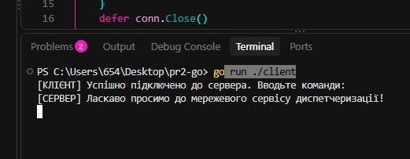
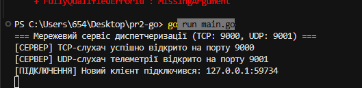

# Пр2 — Device & Dispatcher Gateway

**Виконала:** Тирканич Корнелія з групи КН-41

##  Опис проєкту

**Device & Dispatcher Gateway** — це консольний мережевий сервіс, розроблений мовою програмування Go. Проєкт призначений для диспетчеризації команд і приймання телеметричних даних від пристроїв.

Сервіс підтримує протоколи **TCP та UDP**, багатопотокову обробку клієнтських підключень, потокобезпечну широкомовну розсилку повідомлень і плавне завершення роботи сервера (*Graceful Shutdown*).

## Основні можливості

- TCP-сервер для приймання та обробки команд.
- Паралельне обслуговування клієнтів за допомогою горутин.
- Підтримка текстових команд `ECHO`, `TIME`, `CLOSE` та `QUIT`.
- Реєстрація активних клієнтів і широкомовна розсилка повідомлень (*Broadcast*).
- Синхронізація доступу до спільних даних за допомогою `sync.RWMutex`.
- UDP-сервер для приймання телеметричних даних.
- Передавання телеметрії від UDP-клієнтів до підключених TCP-клієнтів.
- Обробка системних сигналів для коректного завершення роботи.
- Очікування завершення горутин за допомогою `sync.WaitGroup`.
- Перевірка потокобезпечності за допомогою вбудованого інструмента Go Race Detector.

##  Рівні реалізації

###  Рівень 1. Базовий — багатопотоковий TCP-сервер команд

На першому рівні реалізовано TCP-сервер, який приймає клієнтські підключення та обробляє текстові команди.

**Реалізовано:**

- Створення TCP-слухача за допомогою `net.Listen("tcp", ":9000")`.
- Приймання підключень через `Accept()`.
- Обробка кожного клієнта в окремій горутині за допомогою `go s.handleClient(conn)`.
- Построкове читання даних через `bufio.NewReader(conn).ReadString('\n')`.
- Очищення вхідних рядків за допомогою `strings.TrimSpace()`.
- Розділення команд і аргументів через `strings.SplitN()`.
- Обробка команд за допомогою `switch/case`.

**Підтримувані команди:**

| Команда | Призначення |
|---|---|
| `ECHO <текст>` | Повертає клієнту переданий текст. |
| `TIME` | Повертає поточний час у форматі RFC3339. |
| `CLOSE` | Закриває поточне клієнтське з'єднання. |
| `QUIT` | Завершує роботу клієнтського з'єднання. |
| Інша команда | Повертає повідомлення про невідому команду. |

### Рівень 2. Конкурентний — реєстрація клієнтів і Broadcast

На другому рівні реалізовано керування активними клієнтами та потокобезпечну розсилку повідомлень.

**Реалізовано:**

- Структури `Server` і `Client` для організації логіки сервера.
- Зберігання активних з'єднань у `map[net.Conn]*Client`.
- Реєстрацію нових клієнтів і видалення відключених клієнтів.
- Використання `sync.RWMutex` для синхронізації доступу до спільної мапи.
- Застосування `mu.Lock()` і `mu.Unlock()` для зміни даних.
- Застосування `mu.RLock()` і `mu.RUnlock()` для читання даних.
- Реалізацію методу `broadcastMessage()` для розсилки повідомлень клієнтам.
- Автоматичне видалення клієнта після завершення з'єднання через `defer s.unregisterClient(client)`.

**Перевірка потокобезпечності:**

```bash
go run -race .
```

Інструмент `-race` дає змогу виявляти гонитви даних (*data races*) під час виконання програми.

###  Рівень 3. Просунутий — UDP-телеметрія та Graceful Shutdown

На третьому рівні реалізовано приймання телеметричних даних через UDP і коректне завершення роботи сервера.

**UDP-телеметрія:**

- Створення UDP-слухача за допомогою `net.ListenPacket("udp", ":9001")`.
- Приймання датаграм через `ReadFrom(buf)`.
- Отримання адреси відправника та вмісту телеметрії.
- Ретрансляція повідомлень TCP-клієнтам у форматі:

```text
[TELEMETRY from <addr>]: <data>
```

**Обробка системних сигналів:**

- Створення буферизованого каналу `sigChan := make(chan os.Signal, 1)`.
- Реєстрація сигналів `os.Interrupt` і `syscall.SIGTERM`.
- Очікування сигналу завершення роботи, зокрема після натискання `Ctrl+C`.

**Graceful Shutdown:**

- Закриття каналу завершення `s.quit`.
- Надсилання клієнтам повідомлення `SERVER_SHUTTING_DOWN`.
- Закриття TCP-слухача та UDP-сокета.
- Завершення активних операцій і обслуговуючих горутин.
- Очікування завершення горутин за допомогою `sync.WaitGroup`.

Такий підхід дає змогу завершувати роботу сервера контрольовано, не залишаючи активні мережеві ресурси відкритими.

## Використані технології

| Технологія | Призначення |
|---|---|
| Go (Golang) | Основна мова програмування. |
| `net` | Робота з TCP- та UDP-з'єднаннями. |
| `bufio` | Буферизоване читання текстових команд. |
| `strings` | Обробка та розділення рядків. |
| `sync` | Синхронізація горутин і доступу до спільних даних. |
| `os/signal` | Обробка системних сигналів. |
| `syscall` | Робота із сигналом `SIGTERM`. |
| `time` | Отримання та форматування поточного часу. |
| Go Race Detector | Виявлення гонитв даних. |

## Запуск проєкту

### 1. Перевірка встановлення Go

Переконайся, що Go встановлено на комп'ютері:

```bash
go version
```

### 2. Перехід до папки проєкту

Відкрий термінал у корені проєкту, де розташований файл `go.mod`.

### 3. Запуск сервера

```bash
go run .
```

Після запуску сервер очікує TCP-підключення на порту `9000`, а UDP-сокет приймає телеметричні дані на порту `9001`, якщо обидва компоненти запущені в програмі.

### 4. Перевірка потокобезпечності

```bash
go run -race .
```

> **Примітка:** для успішного запуску обидва порти мають бути доступними. Конкретні команди та повідомлення залежать від реалізації клієнта й сервера у вихідному коді.

## Висновок

У ході виконання практичної роботи було реалізовано три рівні мережевого сервісу Device & Dispatcher Gateway мовою Go. Отримано практичні навички створення TCP- та UDP-серверів, паралельної обробки клієнтських підключень за допомогою горутин, синхронізації доступу до спільних ресурсів, широкомовної розсилки повідомлень і коректного завершення роботи сервера.

Робота допомогла закріпити знання про мережеве програмування, конкурентність і потокобезпечність у Go.

